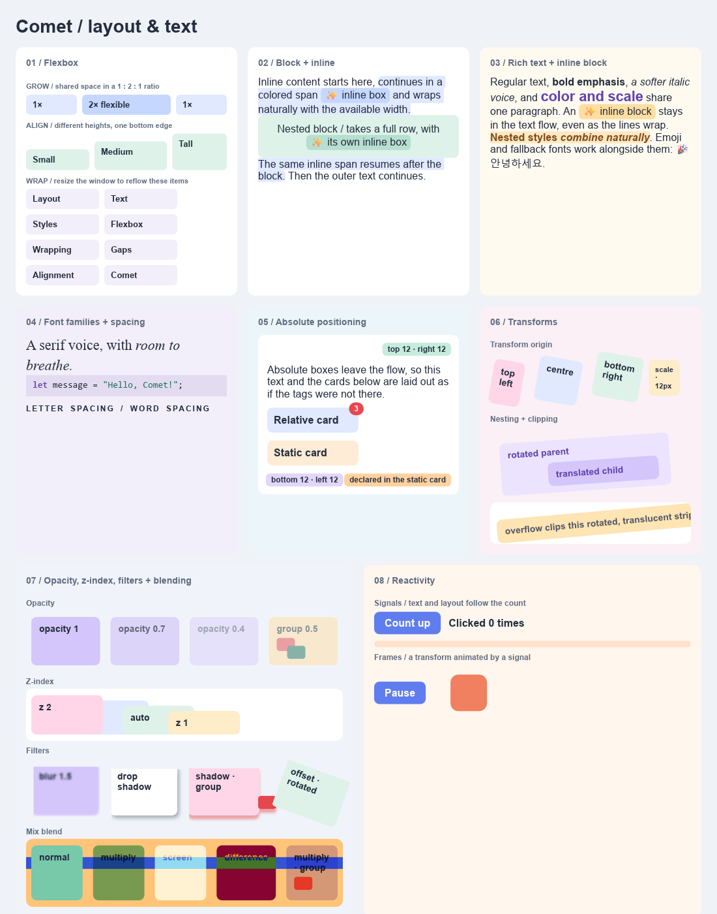

# `Comet`

Comet is a Rust GUI library.

> Comet is in early development stage and rapidly changing.

## Core concepts

### UI Element

- A Ui element can only be text or box.
Comet only provides highly customizable text and boxes.
Allow to avoid mimicking traditional inheritance based design using `View` or `Widget` like traits.
- A Ui element is Entity of Entity Component System.
Composed with multiple prop types, including unresolved styles and other data.
- By using archetypal ECS data structure, it provides type map like flexibility, but same styles are grouped in memory automatically.

### Layout

- Each layout step uses generational arena based tree and implements incrementality using dirty bits.
  - Explicit changes: Style changes, dirty bits marked by caller.
  - Implicit changes: Changes on previous step, dirty bits marked by previous layout step.
- Layout steps are below,
  1. Prelayout: Resolve text styles, builds intermediate input tree which mirrors ui tree.
  2. Layout: Resolve box styles, builds fragment tree.
  3. Prepaint: Resolve paint styles(e.g. border radius, text color), builds prepaint tree.
  4. Layer: Resolve layer styles(e.g. transform, z-index), builds layer tree. TBA: Integrating with os compositor.
- Flow layout(Block + Inline) is builtin.
  - Flow layout requires complex integration between `parley` and `taffy`.
  - Most of rich text styling can be done seamlessly using only boxes and texts.
- Custom container layout algorithm can be defined via `ContainerLayout` trait.

### Content

- Custom contents(image, video, external texture render) can be defined via `Content` trait.
- It can size itself when used as content display.
- It can draw itself when used in content display or background paint.

### Reactivity

- Fine grained reactivity wrapper on top of layout / paint system.
- Each styles knows what layout steps need to be invalidated, hiding manual invalidation.

## Example

Screenshot of example ui in `comet/examples`.
Rendered with `image_render` example.

## AI usage disclosure

This project contains AI generated codes.

## License

Comet is licensed under Apache-2.0
